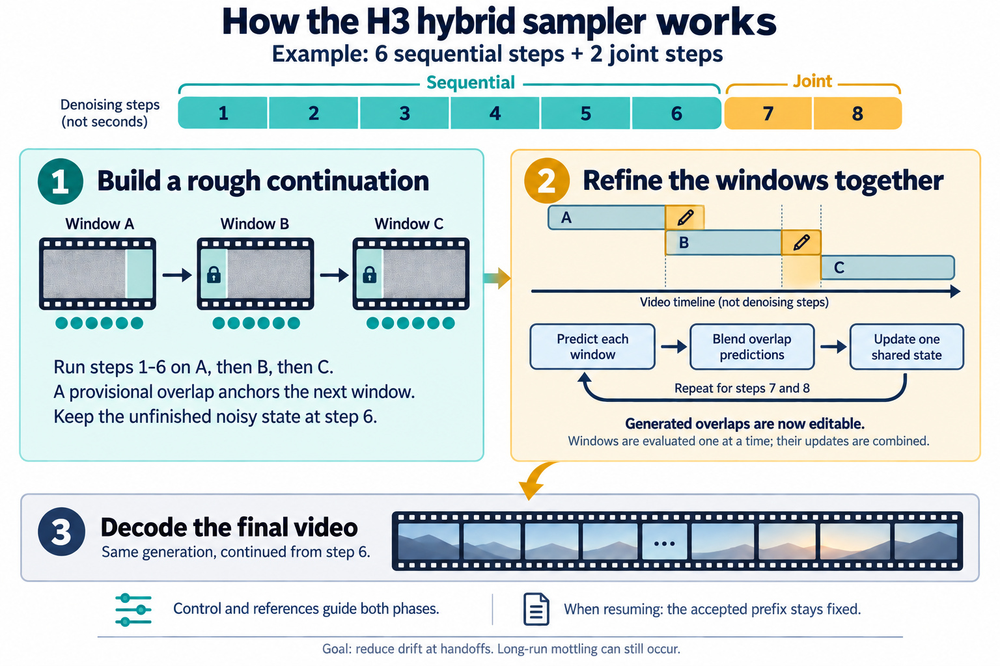

# Hybrid sampling and accepted-prefix resume

`MMH3HybridWindowSampler` starts each window sequentially, then finishes the
generation using predictions from all overlapping windows. It is experimental:
long-run mottling and visible continuation boundaries remain possible.



## How the 6/2 example works

1. Run Euler steps 1–6 on the first window. Use its provisional clean prediction
   to anchor the overlap while running steps 1–6 on the next window. Repeat along
   the timeline. Keep the actual unfinished, float32 noisy state separately.
2. Resume that noisy state at step 7. Evaluate each window, blend its predictions
   with neighboring predictions in the overlap, then update one shared state.
   Repeat for step 8. Generated carry becomes editable; original source masks
   stay fixed. Control and reference conditioning remain active in both phases.
3. Decode the final latent. Prediction fusion happens during inference.

Windows are evaluated one at a time; “joint” describes the shared update.
The switch does not restart the generation or draw fresh noise. The first window
to cover a position owns its initial solver state and fixed noise.

Use plain Euler without churn or random inpaint noise, CFG 1, and a finite,
strictly descending sigma schedule ending at zero. `sequential_steps` can be any
integer from 1 through the number of scheduled steps. Setting it to the full
count gives a sequential baseline. The 6/2 split is an experiment, not a PDD
requirement; another speed LoRA still needs its own compatible schedule and tests.

`MMH3JointWindowSampler` runs the whole schedule with shared window updates. Both
nodes require matching window/overlap settings and one conditioning set per
window. Connect the model before other Context Windows nodes. H3-aligned frame
counts and window starts are required; keyframe guides are not supported here.

## Continuing an accepted prefix

The hybrid sampler's optional `accepted_prefix_frames` fixes the beginning of
its input, including audio, through both phases. Fully accepted windows skip
sequential sampling but remain available as joint context. `start_window` keeps
per-window seed offsets on the original timeline. Defaults of zero mean a fresh
run. This resumes finished chunks, not an interrupted denoising step.

`MMH3LoadResumeRun` selects a completed master/video pair by project and prompt
variant. Leave `master` on **auto (latest completed for this project)**, or select
an older registered master; its paired video follows automatically. With
`resume_from=0`, no previous output is required. Auto refreshes its selection on
each execution and does not choose how many chunks to accept.

`MMH3SaveResumeVideo` wraps native `SaveVideo`. Wire the full master's saved path,
project, and variant to it. After the video saves successfully, it records the
exact pair under `output/latents/h3_resume_runs/`. The master must start at chunk
zero and describe the same frame count as the video. Missing files and
unregistered pairs are not selected automatically. Pre-existing outputs need an
explicit pair record; matching filenames alone are not sufficient.

The existing 05 workflow supplies timeline slicing and assembly through
`H3ContinueMaster`, `H3MergeMasters`, and `H3SaveAVLatent` from its separate workflow
helpers. The sampler and pair-selection nodes do not replace those helpers.
On continuation, that workflow supplies the last accepted window as pinned
context, merges the new latent into the full master, and appends only new decoded
frames to the accepted video. Chunk grid, overlap, resolution, FPS, and source
timeline must match. The saved latent prefix is exact; normal MP4 re-encoding
does not preserve the original compressed bytes or decoded pixels bit for bit.

## Validation

Run these scripts in a ComfyUI Python environment. For a checkout outside
`custom_nodes`, set `PYTHONPATH` to the ComfyUI directory:

```bash
python tests/test_hybrid_sampler.py
python tests/test_joint_sampler.py
python tests/test_resume_runs.py
```

The 20 CPU checks cover actual Euler/inpaint state continuation, window
conditioning and AV fusion, accepted-prefix preservation, global seed offsets,
and completed-pair save/load behavior. Stock-video runtime checks also verified
exact accepted latent values and automatic selection advancing after a new save.
Those checks establish mechanics, not long-generation image quality.
